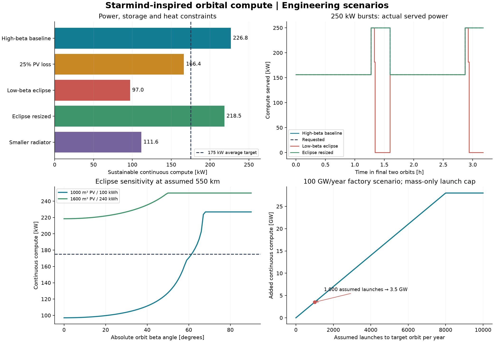

# SpaceX Starmind: solar manufacturing to orbital compute

This offline study uses the November 11, 2026 [BigGo article](https://finance.biggo.com/news/6df155a6-43f9-4a25-8077-010be64ec6c3) as context for a reproducible engineering scenario. It asks whether a solar-powered spacecraft can sustain the published AI1 compute loads, what eclipses and heat rejection change, and whether factory output or launch throughput limits deployment.

**This is a SpaceX-inspired scenario, not a reconstruction of SpaceX's undisclosed design.** All calculations are synthetic. Only the average/peak compute targets are company design claims; the PV, battery, radiator, orbit and launch inputs are assumptions.



## Reproduce and modify

From the repository root, with Python 3.13 or later:

```bash
python -m pip install -e ".[examples]"
python analysis/spacex_starmind/run.py --output outputs/spacex_starmind
python examples/space_business/plot_spacex_starmind.py
```

Or use the repository workspace: `uv sync --all-packages --group lab --group dev`, then prefix the runner with `PYTHONPATH=src uv run python`.

Edit a copy of [spacex_starmind.json](../../examples/space_business/_data/spacex_starmind.json) and pass `--input path/to/inputs.json`. Inputs include evidence status, provenance URLs and scenario overrides. No credentials or live downloads are required. The new API is available from a source checkout; an older PyPI release will not contain it.

The reusable methods are in `orbitalpv.orbital_compute`:

- `OrbitalComputeSpec`: validated design inputs with explicit units.
- `screen_orbital_compute`: continuous compute capacity and necessary PV/storage/radiator sizes.
- `simulate_orbital_compute`: energy-conserving battery dispatch for average/peak compute requests.
- `deployment_screen`: separates factory nameplate, array allocation, launches and usable compute.

Outputs are `scenarios.csv`, `dispatch.csv`, `deployment.csv`, `sensitivity.csv`, `launch_sweep.csv`, and a `provenance.json` containing the complete inputs and their SHA-256. Small reference tables are checked in; full dispatch traces are regenerated.

## Evidence and assumptions

As checked on November 11, 2026:

| Input | Value or treatment | Evidence status |
|---|---|---|
| AI1 compute | 175 kW average; 250 kW peak | [SpaceX company design claim](https://new.spacex.com/spacexai/starmind), not flight measurement |
| Manufacturing agreement | HJT production line; initial line above EUR 60 million, H1 2027 delivery | [SINGULUS announcement](https://www.singulus.com/2026/11/10/singulus-spacex-supply-contract/) |
| 100 GW/year | Sensitivity scale from the news context, with an assumed STC rating basis | Ambition; no claim this is initial-line output or commissioned capacity |
| Orbit | 550 km circular; beta 75° or 0° | Assumption, not an AI1 ephemeris |
| Array footprint / packing | 1,000 m² / 90% | Assumptions; footprint is not deployed height × wingspan |
| Cell conversion | AM0 efficiency 25%, 1,361 W/m² | Assumed effective AM0 efficiency, not an HJT qualification result |
| PV temperature | 75°C, coefficient −0.25%/K relative to 25°C | Imposed values; no coupled panel thermal solution |
| Wiring/mismatch and EPS | 95% each | Separate assumed factors |
| Storage | 100 kWh nominal, SOC 20–90%, 95% charge and discharge efficiency, 300 kW limits | Assumptions |
| Platform | 15 kW | Assumed communications, control and other non-compute loads |
| Radiator | 600 m² **total emitting area**, 330 K, emissivity 0.9 | Assumptions; not a quoted SpaceX radiator area |
| Heat environment / allowance | 50 W/m² absorbed; 40 kW EPS/storage heat allowance | Assumptions, checked against a conservative conversion-loss bound |
| Peak schedule | 250 kW for last 20% of each orbit; 156.25 kW otherwise | Exact 175 kW mean; adverse eclipse alignment |

The supplier does not disclose initial-line throughput or cell efficiency. Its announcement describes more than 100 GW of equipment without an annual rate or completion date. Therefore no factory cost per watt, satellite production schedule, or project profitability is inferred from the EUR 60 million contract. SpaceX's dimensional and mass-efficiency statements are not used to infer PV area or spacecraft mass.

## Calculations and interpretation

Sunlit bus power is `irradiance × footprint × packing × AM0 efficiency × temperature factor × array derate × EPS efficiency × retention`. It is **241.82 kW** in the baseline. Factory sizing separately uses 1,000 W/m² STC and an independently assumed STC efficiency. The equal 25% efficiencies are assumptions, not a spectral conversion model.

The circular shadow gives a **95.65-minute** orbit and **35.61-minute** eclipse at beta 0°. A sun-synchronous orbit does not automatically eliminate eclipses; the beta-75° case is a representative illuminated orbit, not proof of year-round sunlight. See [NASA's thermal guidebook](https://ntrs.nasa.gov/api/citations/20220006584/downloads/NASAPassiveThermalGuidebookv5%201Public.pdf).

For sunlight duration `ts`, eclipse duration `te` and battery round-trip efficiency `eta`, the constant bus energy bound is `Psolar × ts / (ts + te/eta)`. Storage energy and converter power impose additional limits. The model uses OrbitalPV's existing `periodic_load_limit` and independently checks repeatability with `dispatch_power`.

Net radiator flux is `emissivity × sigma × (T⁴ − 3⁴) − absorbed_environment`. Subtract the EPS/storage heat allowance and platform load before allocating heat rejection to compute. This follows a [radiative energy balance](https://www.nasa.gov/smallsat-institute/sst-soa/thermal-control/); the vacuum is not an unlimited cooling sink. The radiator temperature is prescribed, not a predicted chip temperature.

| Scenario | Continuous compute ceiling | Mean compute actually served under the burst schedule | 175 kW continuous target |
|---|---:|---:|---|
| High-beta baseline | 226.82 kW | 175.00 kW | Pass |
| 25% imposed PV loss | 166.37 kW | 165.58 kW | Fail |
| Low-beta eclipse | 97.04 kW | 134.85 kW | Fail |
| Eclipse, resized to 1,600 m² PV and 240 kWh | 218.47 kW | 175.00 kW | Pass |
| Radiator reduced to 300 m² emitting area | 111.56 kW | 111.56 kW | Fail |

The burst average can exceed the continuous ceiling by concentrating service in sunlight. That is intermittent service, not additional firm capacity. In the overloaded low-beta case the greedy dispatcher also leaves **18.93 kWh of platform demand unserved** over the reported 7.97 hours: it prioritizes the platform within each interval but does not reserve energy for its future eclipse demand. A mission controller must curtail compute earlier. This unsafe schedule is reported as a failure, not an operable flight plan.

Each scenario runs 40 repeated orbits from the SOC reserve floor. Reported service uses the final five orbits, verifies no net SOC depletion across that reporting window, and includes balance errors and thermal-allowance checks. A full initial battery cannot conceal an unsustainable energy budget.

For **constant** 175 kW compute plus 15 kW platform load, the low-beta assumptions need at least **1,302.08 m² PV, 169.58 kWh nominal storage, 124.87 kW charge and 190 kW discharge capability**. At 330 K the thermal assumptions require **414.25 m² total emitting area**, including the 40 kW allowance. These are separate necessary conditions, without design margin. The larger 1,600 m² / 240 kWh example additionally passes the modeled burst profile.

## Factory-to-orbit scaling

The illustration assumes 100 GW/year factory nameplate × 80% utilization × 90% yield × 50% space allocation = **36 GW/year** allocated cell output on an assumed STC basis. The baseline array needs **225 kW STC** including inactive packing area, allowing **160,000 arrays/year**. This is a material-equivalent count, not flight-qualified satellites produced.

At a hypothetical **5 t complete spacecraft**, **100 t payload to the target orbit** and **1,000 launches/year**, the mass-only ceiling is **20,000 satellites/year**: **4.5 GW/year of array STC capacity** and **3.5 GW of added continuous compute capacity** when capped at the 175 kW service target. At assumed 85% compute utilization this becomes **2.975 GW average utilized electrical compute load**. Deploying all allocated arrays would require 8,000 such launches. The resized spacecraft is separately assumed to weigh 8 t; its launch-limited increment is only 2.1 GW despite sufficient individual power capacity.

This excludes fairing volume, orbit insertion penalties beyond the supplied payload limit, assembly, qualification yield beyond the assumed factor, launches lost, replacements, collision avoidance, orbital permissions, communication contention and ground gateways. It does not predict actual Starship payload, flight rate or satellite production.

## Limits and checks

The model does not estimate useful AI work, tokens/s, FLOPS, workload accuracy, revenue, launch cost or terrestrial cost competitiveness. Those need hardware benchmarks, networking and cost inputs. Radiation damage is a retention sensitivity, not a validated HJT lifetime model. The 600 m² radiator area counts emitting faces once each; blocked faces must be removed. Thermal transport, junction temperatures, fluid loops, transient heat storage, micrometeoroid exposure and structural design are outside this screening calculation.

Tests cover independent power/thermal arithmetic, repeatable continuous service, conservation of energy, SOC bounds, eclipse/burst boundary resolution, overloaded cases, and deployment unit conversion/limits. These checks validate implementation consistency, not SpaceX hardware.
